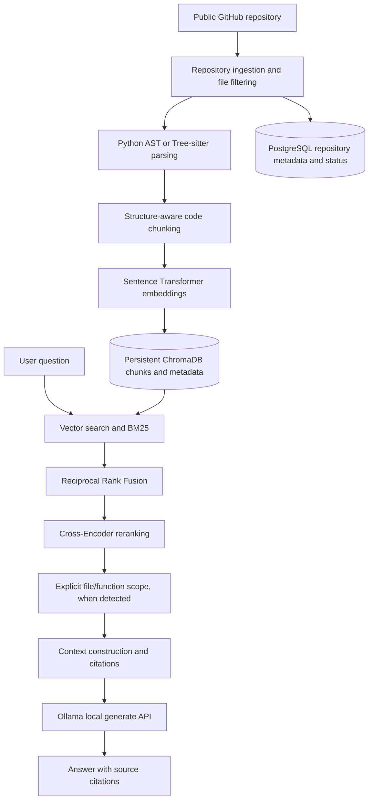

# RepoLens AI

RepoLens AI is a repository-aware Retrieval-Augmented Generation (RAG) assistant. It indexes source code from a public GitHub repository so developers can ask implementation questions and receive answers with citations to the retrieved files, symbols, line ranges, and source snippets.

It is intended to make an unfamiliar codebase easier to explore: connect a repository, let the backend parse and index supported source files, then ask about functions or execution flows in the React interface or API. Answers are generated locally through Ollama using the repository context selected by retrieval.

## Key features

- **Public GitHub ingestion:** retrieves repository metadata and source files, filtering unsupported and generated files and applying per-file and total download size limits.
- **Python AST and Tree-sitter parsing:** Python uses the standard-library AST parser. JavaScript, JSX, TypeScript, TSX, and Java use Tree-sitter grammars.
- **Structure-aware chunking:** creates code chunks with file path, language, symbol, parent class, line range, and chunk index metadata; oversized symbols are split into smaller chunks.
- **Sentence Transformer embeddings:** embeds chunks and queries with `sentence-transformers/all-MiniLM-L6-v2` on CPU.
- **Persistent ChromaDB storage:** stores repository chunks, embeddings, and source metadata locally under `backend/data/chroma` when the backend is run from the `backend/` directory.
- **BM25 keyword retrieval and vector search:** combines lexical and semantic retrieval using Reciprocal Rank Fusion (RRF), then reranks candidates with `cross-encoder/ms-marco-MiniLM-L-6-v2`.
- **Local LLM inference:** sends a bounded repository context to the Ollama generate API. The default model is `llama3.2:1b`.
- **Source citations:** returns file paths, symbols, line ranges, and the actual snippets included in the constructed context.
- **Deterministic file/function context scoping:** when a question explicitly names a supported source file or function, matching retrieved chunks are selected before context and citations are constructed. If no retrieved chunk matches, the service falls back to the unfiltered retrieved set.
- **React frontend:** provides repository connection, repository selection and status, indexing actions, question-and-answer chat, and expandable source citations.

## Technology stack

| Area | Technologies |
|---|---|
| Backend API | Python 3.11, FastAPI, Uvicorn, Pydantic |
| Database and migrations | PostgreSQL, SQLAlchemy, Psycopg, Alembic |
| Repository ingestion and parsing | PyGithub, Python `ast`, Tree-sitter language pack |
| Retrieval and AI | Sentence Transformers, BM25, Reciprocal Rank Fusion, Cross-Encoder, Ollama |
| Vector storage | ChromaDB persistent client |
| Frontend | React 19, JavaScript (JSX), Vite, CSS |
| Testing | Pytest test suite (install Pytest separately; it is not currently listed in `backend/requirements.txt`) |

## Architecture

Repository indexing and question answering are separate flows. Indexing downloads supported files from GitHub, parses and chunks them, creates embeddings, and stores chunks in ChromaDB. Repository metadata and status are stored in PostgreSQL. For a question, RepoLens retrieves semantic and keyword candidates, fuses and reranks them, applies any explicit file/function scope, constructs a context, and asks Ollama to generate an answer. Citations are built from the same chunks used for context.



## Project structure

```text
RepoLens-AI/
├── backend/
│   ├── app/
│   │   ├── api/                 # Repository and question routes
│   │   ├── core/                # PostgreSQL engine and session dependency
│   │   ├── models/              # SQLAlchemy models
│   │   ├── schemas/             # Request and response validation
│   │   └── services/
│   │       ├── analysis/        # Python AST and Tree-sitter parsers
│   │       ├── chunking/        # Structure-aware code chunking
│   │       ├── embeddings/      # Sentence Transformer embeddings
│   │       ├── ingestion/       # GitHub access, filtering, and downloading
│   │       ├── rag/             # Context construction and Ollama client
│   │       └── retrieval/       # ChromaDB, BM25, hybrid retrieval, reranking
│   ├── data/                    # Local ChromaDB persistence (generated)
│   ├── migrations/              # Alembic migrations
│   ├── tests/                   # Backend tests
│   ├── alembic.ini
│   └── requirements.txt
├── frontend/
│   ├── public/                  # Static frontend assets
│   ├── src/                     # React components, API client, and CSS
│   ├── .env.example             # Vite API configuration example
│   └── package.json
└── README.md
```

## Setup and installation

### Prerequisites

- Python 3.11
- Node.js and npm
- PostgreSQL
- Ollama
- Git

The embedding and Cross-Encoder models are loaded on demand and may be downloaded the first time the corresponding services run. Ensure the machine can access the model registry on first use.

### 1. Create a Python environment and install backend dependencies

From the repository root, in PowerShell:

```powershell
py -3.11 -m venv .venv
.\.venv\Scripts\Activate.ps1
Set-Location backend
python -m pip install --upgrade pip
python -m pip install -r requirements.txt
```

If PowerShell blocks activation, use the Python executable directly as `.\.venv\Scripts\python.exe` from the repository root.

### 2. Configure PostgreSQL

Create a PostgreSQL database and a user with permission to create and update tables. The backend reads the following required variables from `backend/.env`:

```dotenv
DB_HOST=localhost
DB_PORT=5432
DB_NAME=repolens_ai
DB_USER=your_local_database_user
DB_PASSWORD=replace_with_your_local_password
```

There is currently no `backend/.env.example` in the repository, so create `backend/.env` manually with values for your local database. Keep credentials private and do not commit this file.

With the virtual environment active and the working directory set to `backend/`, apply the Alembic migrations:

```powershell
alembic upgrade head
```

The current migration creates the `repositories` table.

### 3. Start Ollama and fetch the default model

Install Ollama for your operating system, start its local service, then run:

```powershell
ollama pull llama3.2:1b
```

The backend defaults to `http://localhost:11434` and `llama3.2:1b`. Optional overrides are documented below.

### 4. ChromaDB storage

ChromaDB uses its embedded persistent client; no separate ChromaDB server is configured. When the backend is started from `backend/`, its index is written under `backend/data/chroma/`. This directory is generated local data and is ignored by Git. Keep the backend working directory consistent so the same index is used between runs.

### 5. Install frontend dependencies

In a separate terminal, from the repository root:

```powershell
Set-Location frontend
npm ci
```

For development, Vite proxies `/repositories` and `/health` to `http://127.0.0.1:8000` by default. The checked-in `frontend/.env.example` documents optional frontend settings; copy it to `frontend/.env.local` only if you need to override defaults.

## Environment configuration

| Variable | Required | Default | Purpose |
|---|---:|---|---|
| `DB_HOST` | Yes | — | PostgreSQL host |
| `DB_PORT` | Yes | — | PostgreSQL port |
| `DB_NAME` | Yes | — | PostgreSQL database name |
| `DB_USER` | Yes | — | PostgreSQL user |
| `DB_PASSWORD` | Yes | — | PostgreSQL password |
| `OLLAMA_BASE_URL` | No | `http://localhost:11434` | Ollama service base URL |
| `OLLAMA_MODEL` | No | `llama3.2:1b` | Model passed to Ollama's generate API |
| `OLLAMA_TIMEOUT` | No | `120` seconds | HTTP request timeout for generation |
| `VITE_API_BASE_URL` | No | empty | Browser-visible API base URL; empty uses same-origin paths and the Vite proxy in development |
| `REPOLENS_API_TARGET` | No | `http://127.0.0.1:8000` | Backend target used by the Vite development proxy |

The backend reads database settings from `backend/.env`. Ollama variables are optional process environment variables. Vite variables are read by the frontend build/dev server from its environment files; `VITE_API_BASE_URL` is exposed to browser code, so do not put secrets in it.

The ChromaDB path and embedding/reranker model names are currently defaults in code rather than configurable environment variables.

## Running the application

### Backend

Make sure PostgreSQL and Ollama are running, the `backend/.env` file is configured, and migrations have been applied. From the `backend/` directory with the virtual environment active:

```powershell
uvicorn app.main:app --reload
```

The API is available at `http://127.0.0.1:8000`. Interactive OpenAPI documentation is at `http://127.0.0.1:8000/docs`.

### Frontend

In a separate terminal, from `frontend/`:

```powershell
npm run dev
```

Open the Vite URL printed in the terminal (the development server binds to `127.0.0.1`).

To create a production frontend bundle:

```powershell
npm run build
```

## API endpoints

All endpoints are served by the FastAPI backend. Repository IDs are integer database IDs.

| Method | Path | Description |
|---|---|---|
| `GET` | `/` | Basic application status message |
| `GET` | `/health` | Application health check |
| `GET` | `/health/database` | PostgreSQL connectivity check |
| `POST` | `/repositories/` | Create a repository metadata record |
| `POST` | `/repositories/ingest` | Ingest and index a public GitHub repository synchronously |
| `POST` | `/repositories/{repository_id}/index` | Ingest and index an existing pending or failed GitHub record |
| `GET` | `/repositories/` | List repository records, newest first |
| `GET` | `/repositories/{repository_id}` | Get one repository record |
| `POST` | `/repositories/{repository_id}/ask` | Ask a question about an indexed repository |

Example: ingest a public GitHub repository:

```powershell
curl.exe -X POST http://127.0.0.1:8000/repositories/ingest `
  -H "Content-Type: application/json" `
  -d '{"source_url":"https://github.com/owner/repository"}'
```

Example: ask a question after ingestion completes and the repository is indexed or partial:

```powershell
curl.exe -X POST http://127.0.0.1:8000/repositories/1/ask `
  -H "Content-Type: application/json" `
  -d '{"question":"How does the worker select and execute queued jobs?"}'
```

The answer response has `repository_id`, `answer`, and `sources`. Each source may include `file_path`, `symbol_name`, `start_line`, `end_line`, and `snippet`. A repository that is not indexed cannot be queried. Ingestion is synchronous, so a request can take time for large repositories or first-time model downloads.

`POST /repositories/` creates a metadata record only; the implemented ingestion flow is for public GitHub URLs. A ZIP upload flow and private-repository authentication are not currently implemented.

## Tests

Backend tests are under `backend/tests/`. From the `backend/` directory, with the environment active:

```powershell
python -m pip install pytest
python -m pytest -v
```

The test suite includes unit and integration-style tests for ingestion, filtering, parsing, chunking, embedding and vector-store wrappers, retrieval/reranking, RAG context and citations, and API behavior. Some service tests use mocks; passing them does not by itself validate a live PostgreSQL, ChromaDB, or Ollama setup.

## Current scope and limitations

- GitHub ingestion currently accepts public GitHub repository URLs and indexes Python, JavaScript, JSX, TypeScript, TSX, and Java source files. Private GitHub authentication and ZIP upload ingestion are not implemented.
- File download limits are 1 MB per file and 20 MB total per repository. Unsupported/generated files and files that cannot be decoded as UTF-8 are skipped.
- Ingestion and indexing run synchronously in the API request. This is suitable for a local project workflow but may not suit large repositories or production-scale background processing.
- Question answering uses the top seven reranked chunks, with a maximum constructed context of 12,000 characters. Explicit file/function scoping is applied only to chunks already returned by retrieval; if it finds no match, the unfiltered retrieved set is used.
- Prompts and citations encourage source-grounded answers but do not guarantee that every generated statement is correct. Verify important details in the cited code.
- The API does not currently include user authentication or authorization.
- A project license has not yet been specified.

## License

No license has been specified yet. Until one is added, reuse and redistribution permissions are not granted by this repository.
